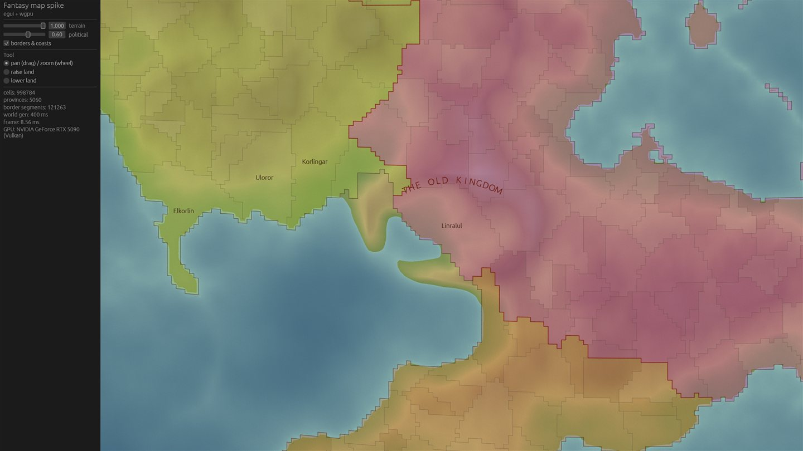
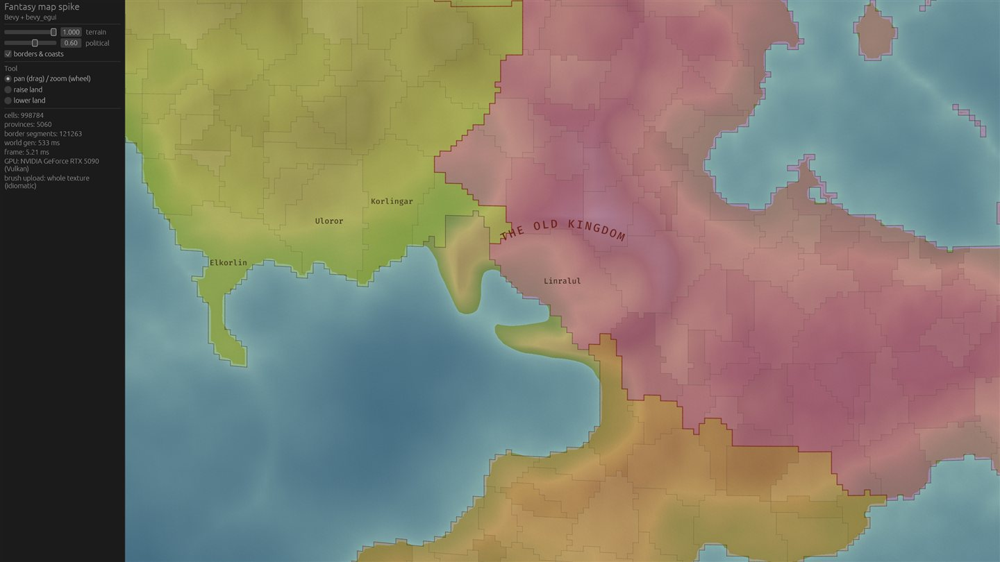

# Renderer trial: Bevy vs egui + wgpu

October 14, 2026. Question from the design doc: which app shell should draw the map and the panels?

**Decided Oct 14, 2026: egui + wgpu.** The user accepted the recommendation below.

**Recommendation: egui + wgpu (via eframe).** Both draw the same picture at about the same speed. egui wins
on what is certain:

- It updates only the part of a texture that changed. Bevy's standard path re-uploads the whole texture.
- It needed no engine defaults switched off. Bevy needed three.
- It rebuilds about 5× faster after a change, which matters when an agent iterates on the code.
- It is a fifth of the size.

**Open risk, not yet explained:** on the weak integrated GPU, Bevy crashed in 15 of 17 runs with border lines
on, while egui never crashed drawing the same lines. I didn't find the cause, and it may be a mistake in my
Bevy line setup rather than a Bevy defect (see Finding 2).

Bevy would be worth revisiting if the project ever wants 3D, an asset pipeline, or many animated sprites.
None of that is in the design today. **This is a recommendation; the decision is yours.**

| egui + wgpu | Bevy |
| --- | --- |
|  |  |

## What was built

The same map view was built twice. Everything that is not "framework glue" is shared, so the comparison
measures only the glue:

- **Shared world code** (`spike_world`, ~830 lines, no graphics dependency): a cube-sphere planet with
  ~1M cells, noise terrain, ~5,000 provinces grown organically in 48 realms, border tracing, the flat map
  projection, mouse picking, the brush, and the benchmark script.
- **Shared shader** (`shaders/map_common.wgsl`): screen pixel → longitude/latitude → cube face → cell,
  terrain colours with hill shading and a parchment tint, the political layer, and border-line drawing.

Each app does the same six things:

1. Draws the planet as a flat map that wraps east–west.
2. Stacks terrain and political layers with opacity sliders.
3. Pans and zooms.
4. Draws ~121,000 border and coast segments on the GPU, plus place names and one label curved along an arc.
   Neither library does curved text, so the label is placed glyph by glyph.
5. Shows an egui side panel.
6. Has a brush that raises or lowers land under the mouse and updates the map live.

I built the egui app first and Bevy second. Bevy therefore benefited from the lessons learned on the first app.

## Results

Frame times in milliseconds, median (p50) / 95th percentile (p95), taken as the median across runs. Lower is
better; 8.4 ms is 120 frames a second.

| Setup | Runs | Pan | Zoom | Brush | Upload per brush stroke |
| --- | --- | --- | --- | --- | --- |
| egui, RTX 5090 | 3 | 8.4 / 10.1 | 8.4 / 19.2 | 8.4 / 8.7 | 1.7 KB |
| egui, integrated Radeon | 6 | 12.4 / 13.4 | 10.8 / 13.2 | 9.9 / 10.5 | 1.7 KB |
| Bevy, RTX 5090 (standard brush) | 3 | 8.4 / 8.8 | 8.4 / 9.2 | 8.4 / 10.0 | 3.9 MB |
| Bevy, RTX 5090 (hand-written patch upload) | 3 | 8.4 / 9.0 | 8.4 / 10.7 | 8.4 / 11.5 | 1.7 KB |
| Bevy, integrated Radeon (the 2 runs that didn't crash) | 2 | 11.1 / 11.8 | 11.0 / 36.3 | 11.7 / 12.4 | 3.9 MB |
| Bevy, integrated Radeon, border lines off | 4 | 8.4 / 8.7 | 8.4 / 8.7 | 8.8 / 9.3 | 3.9 MB |

| | egui + wgpu | Bevy |
| --- | --- | --- |
| App-specific code (Rust + WGSL) | ~490 lines | ~580 lines (incl. ~25 for the patch upload, ~20 for benchmark switches) |
| Crates pulled in | 168 | 370 |
| Release program size | 14 MB | 72 MB |
| Rebuild after a one-line change (debug / release) | 3.1 s / 2.4 s | 19.8 s / 13.0 s |
| Breaking releases in 2026 | 0.34.x by May, 0.35 June, 0.36 August | 0.19 June, 0.20 October 8 |
| Crashes on the integrated Radeon | 0 of 8 runs | 15 of 17 runs with border lines; 0 of 4 without |

How to read the numbers:

- The window was 1920×1080 at 150% Windows scaling, so 2880×1620 physical pixels. Vsync was off.
- **The RTX 5090 is capped at 8.4 ms (120 frames a second) by something system-wide.** Both apps hit the
  cap identically, on Vulkan and on DirectX 12. It is probably a driver frame limiter or the monitor's
  refresh rate. On the 5090 the result is simply "both are easily at the limit", so the integrated-GPU
  numbers are the informative ones.
- The integrated GPU is the small Radeon built into your Ryzen 7800X3D. It is weaker than most laptop
  graphics, so it is a pessimistic stand-in for the design's "laptop with integrated graphics" floor. Both
  apps run the 1M-cell map at 80–100 frames a second on it, so **that hardware floor holds**.

## Findings

1. **Same picture, same speed.** Both apps draw identical maps from the same shader. On the integrated GPU
   they trade small wins: Bevy pans slightly faster (11.1 vs 12.4 ms), and egui brushes slightly faster
   (9.9 vs 11.7 ms). Drawing speed does not decide this.

2. **Bevy is unstable on the integrated Radeon, and the cause is unresolved.** With border lines on, Bevy
   crashed with a driver "device lost" error within its first 1–2 seconds in 15 of 17 runs. That happened
   on Vulkan and on DirectX 12, in Bevy's compatibility mode, and with shaders compiled up front. With
   border lines off, it ran 4 of 4 times. egui draws exactly the same lines, from the same shader, on the same
   GPU, and never crashed (8 of 8).
   - I fixed one real bug on the way: Bevy drew a frame before the view was set, so the shader divided by
     zero. The crash continued after the fix.
   - I stopped at the timebox without finding the root cause. **It could still be a mistake in my Bevy line
     setup rather than a Bevy defect.** Either way, it is risk that egui does not carry.

3. **Bevy's standard way of updating a texture re-uploads all of it.** Changing an `Image` asset makes
   Bevy copy the whole texture to the GPU, 3.9 MB per brush stroke against 1.7 KB for the patch that
   changed. On this map the cost is small, about 0.6 ms per frame on the integrated GPU, and manageable at
   today's sizes.
   - It becomes a real cost only for per-cell layers that change often. Examples are the weather layer
     (daily, per the design's rendering table), climate overlays (monthly), and terrain painting in the
     scenario editor.
   - Ownership changes are *not* affected. Realm colours live in a small per-province colour table, about
     256×20 pixels. The per-cell province texture only changes when borders are redrawn.
   - Uploading only the patch takes ~25 lines of hand-written Bevy render-world code. It worked first time
     and closed the gap. In egui it is one `write_texture` call.

4. **Bevy's game-engine defaults had to be switched off three times.**
   - It drops to 60 frames a second whenever its window loses focus. That made Bevy look half as fast until
     I found it.
   - Its 2D pass has a depth buffer, which hid the border lines behind the map.
   - Its sRGB colour target needed manual colour conversion, plus turning off tone mapping and
     anti-aliasing to match egui.

   Each default is sensible for a game. Here they were friction. egui needed none of this. The vsync setting
   was needed in both.

5. **Iteration speed.** A one-line change rebuilds in ~2–3 s with egui against ~13–20 s with Bevy. Bevy
   offers a dynamic-linking mode for development builds that should narrow this; I didn't try it. Over a
   project built mostly by an agent running build-test loops, this adds up.

6. **What Bevy's entity system would buy us is small here.** The design keeps the simulation in its own
   plain-Rust crate, so Bevy's entity system would only organise the app side: a map, panels, labels and
   later some army and city icons. egui with our own wgpu passes handles that directly. Bevy's real
   strengths (3D, sprites and animation, asset hot-reloading, audio, a scene editor ecosystem) are not on the
   design's path. The design explicitly rules out a globe view.

7. **Churn exists on both sides.** egui ships a breaking release every month or two, Bevy every four months
   or so. The egui-facing code is smaller and simpler (a paint callback and panels), so each upgrade should
   touch less. The plugin connecting Bevy and egui caught up with Bevy 0.20 within two days this time.

### Things the trial taught us about the design (any renderer)

- **The cube-sphere grid works.** Neighbours across face edges and corners are correct and symmetric. The
  largest cell is 1.40× the smallest. Mouse picking matches the drawn map exactly. A 1M-cell world with
  5,000 provinces generates in ~0.3–0.6 s (2.8 s on a cold first run).
- **Hardware cubemaps are the wrong tool.** The layers are 6-layer array textures, and the shader does its
  own cube-face maths. The design doc has been corrected.
- **Borders need smoothing.** Borders drawn along cell edges look like staircases, which is not the
  hand-drawn look. Smoothing the border chains (e.g. corner-cutting curves) is a renderer task for build step 2.
- **The editor needs incremental border rebuilds.** The brush can turn sea into land, but coastlines are
  traced once, so they don't follow. Re-tracing only the touched region is a scenario-editor requirement.
- **Poles on the flat map.** Border segments near the poles stretch across the equirectangular view and are
  hidden for now. This feeds the open question of which projection to use.

## How to run

Interactive. Drag to pan, scroll to zoom, or pick "raise land" in the panel and drag to paint:

```
cargo run --release --manifest-path M:\claud_projects\fantasymap\spikes\Cargo.toml -p spike_egui
cargo run --release --manifest-path M:\claud_projects\fantasymap\spikes\Cargo.toml -p spike_bevy
```

Options for both apps:

- `--n <face size>`: 408 ≈ 1M cells, 256 ≈ 400k, 128 ≈ 100k.
- `--provinces <count>`.
- `--bench`: a scripted pan, zoom and 300 brush applications, then a screenshot and a JSON report.
- `--out <dir>`, `--tag <name>`.

Environment variables:

- `WGPU_POWER_PREF=low` (integrated GPU) or `high` (discrete).
- `WGPU_BACKEND=dx12` or `vulkan`.
- Bevy only: `BEVY_PARTIAL=1` (patch upload instead of whole-texture re-upload).
- Bevy only, diagnostic switches: `BEVY_NO_LINES=1`, `BEVY_NO_TEXT=1`, `BEVY_FREEZE_MATERIALS=1`,
  `BEVY_SYNC_PIPELINES=1`.

The benchmark scripts (Windows PowerShell; they write to `W:\temp\claude\fantasymap-spike\out` by default) and the raw per-run JSON results behind the tables are in `bench/`.

Tests for the shared code:

```
cargo test --release --manifest-path M:\claud_projects\fantasymap\spikes\Cargo.toml -p spike_world
```
